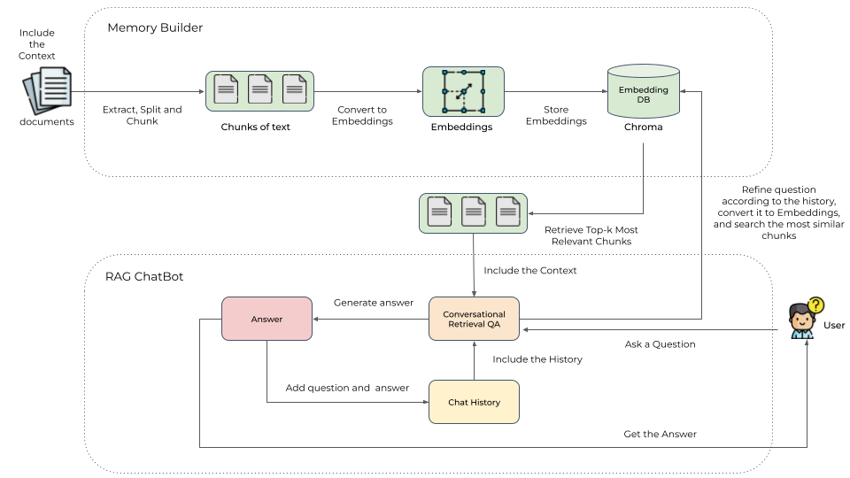

# RAG Chatbot

A local, document-aware chatbot built for searching and answering questions from your own knowledge base using a retrieval-augmented generation (RAG) pipeline.

This project combines a Python backend, a React frontend, and local open-source models to let you ingest documents, index them semantically, and ask questions in natural language without sending your data to a third-party hosted AI service.

## Why this project

This repository is designed for running a chatbot on your own machine or local development environment with:

- local LLM inference through llama.cpp
- semantic document indexing using sentence-transformers and Chroma
- conversation-aware responses grounded in retrieved source documents
- support for markdown document upload and indexing
- a simple frontend for testing the workflow end-to-end

The goal is to make it easy to build a private knowledge assistant over your own files, notes, documents, and project documentation.

## Project overview

- Backend: FastAPI service for chat and document APIs
- Frontend: Vite + React + TypeScript UI
- Memory layer: document chunking, embeddings, and vector search
- Model layer: local GGUF model inference via llama.cpp
- Workflow: ingest docs → chunk text → embed → store in vector database → retrieve relevant context → answer

## Features

- Ask questions against uploaded or existing markdown files
- Keep chat context across the current conversation
- Build and refresh a local vector index for retrieved content
- Support multiple synthesis strategies for answer generation
- Run model inference locally with open-source GGUF models
- Use a browser-based interface for interacting with the system

## Architecture



The app follows a standard RAG design:

1. Documents are loaded and split into manageable chunks.
2. Each chunk is converted into an embedding and stored in a vector database.
3. A user question is embedded and matched against the indexed chunks.
4. The most relevant chunks are retrieved as context.
5. A local LLM generates a grounded answer using that context.
6. Conversation memory is preserved so follow-up questions can build on prior context.

The project also includes response synthesis patterns for handling larger retrieval contexts, including structured context refinement and hierarchical summarization.

## Repository structure

```text
.
├── backend/              # FastAPI app and API routes
├── chatbot/              # retrieval, memory, model, and conversation logic
├── frontend/             # React frontend
├── docs/                 # markdown documents used as knowledge source
├── images/               # screenshots and demo assets
├── models/               # downloaded models
├── tests/                # automated tests
├── docker-compose.yml    # local container setup
├── Makefile              # project commands
├── pyproject.toml        # Python dependencies and project config
├── README.md             # project documentation
├── start.sh              # app launcher script
└── ...
```

## Tech stack

- Python 3.12+
- Poetry
- FastAPI
- SQLModel / Alembic
- Chroma vector database
- Sentence Transformers
- PyTorch / Transformers
- llama.cpp via Docker
- Vite, React, TypeScript
- pytest

## Prerequisites

Before running the project, make sure you have:

- Python 3.12+
- Poetry 2.3.0+
- Docker and Docker Compose
- A CUDA-capable GPU or Apple Silicon system if you want local GPU acceleration
- Node.js and Yarn for the frontend

## Quick start

### 1) Install dependencies

```bash
poetry install
```

### 2) Initialize the database

```bash
make migrate_db
```

### 3) Start the local model server

For NVIDIA / CUDA-based systems:

```bash
make setup_cuda
```

For macOS with Metal acceleration:

```bash
make setup_metal
```

This starts the local llama.cpp service required by the backend.

### 4) Build the knowledge index

Place your markdown files in the `docs` folder and then run:

```bash
python chatbot/memory_builder.py --model-name jinaai/jina-embeddings-v5-text-small-retrieval --chunk-size 1000 --chunk-overlap 50
```

This creates or updates the vector index used for retrieval.

### 5) Start the app

Start the backend:

```bash
cd backend && PYTHONPATH=.:../chatbot uvicorn main:app --reload
```

Start the frontend in a separate terminal:

```bash
cd frontend && yarn dev
```

Or use the project shortcut:

```bash
make start
```

The frontend should be available at http://localhost:5173 and the API at http://localhost:8000.

## Environment and model configuration

The application expects a local model setup for inference and an embedding model for retrieval.

Typical values look like this:

```bash
MODEL="Meta-Llama-3.1-8B-Instruct-Q4_K_M"
MODEL_URL="https://huggingface.co/bartowski/Meta-Llama-3.1-8B-Instruct-GGUF/resolve/main/Meta-Llama-3.1-8B-Instruct-Q4_K_M.gguf"
EMBEDDING_MODEL="all-MiniLM-L6-v2"
SYNTHESIS_STRATEGY="tree-summarization"
```

The actual model you choose depends on your hardware, memory, and speed requirements. Smaller models are easier to run locally; larger models provide better reasoning but need more resources.

> Important: if you change the embedding model, rebuild the vector index because the embedding space changes.

## Development commands

The project includes useful commands in the Makefile:

```bash
make check
make setup_cuda
make setup_metal
make start
make stop_llama_server
make update
make tidy
make test
make clean
```

## Running tests

```bash
make test
```

## Notes

- This project is designed to work with your own local knowledge base and local models.
- Keep the documents you want indexed in the `docs` directory or upload them through the app.
- For best results, choose a model that fits your available VRAM or system memory.
- The app works best when the document sources are clean, structured, and relevant to the questions you want answered.

## License

This project does not currently declare a custom license in the repository metadata. If you plan to share or redistribute it, confirm the license terms before publication.

## Contributing

Contributions are welcome if they improve the project’s reliability, UX, configuration, or local-model workflow. If you make changes, keep the setup simple, reproducible, and aligned with the repository’s current architecture.
